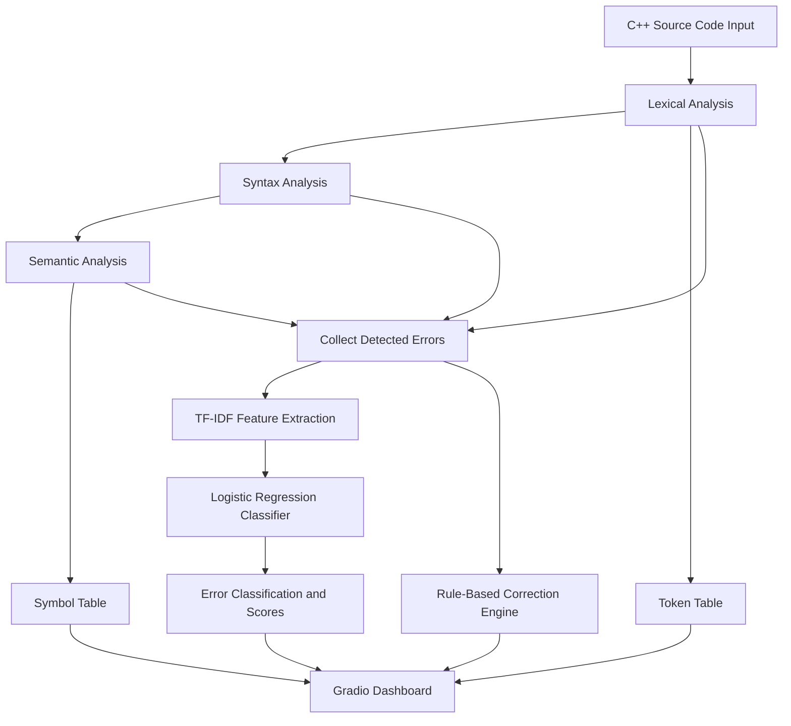

# AI-Enhanced-Compiler-for-Detecting-and-Correcting-Programming-Errors-
Our project, AI-Enhanced Compiler for Detecting and Correcting Programming Errors, aims to identify, classify, and correct programming errors. It combines compiler techniques with machine learning methods like TF-IDF and Logistic Regression to analyze error messages and suggest fixes, making debugging faster and easier, especially for beginners.
# CodeGuard AI
### AI-Enhanced Compiler for Detecting and Correcting Programming Errors

CodeGuard AI is a machine-learning-assisted programming error detection and correction prototype designed to help programmers identify common errors in C++ source code. It combines basic compiler design techniques with Natural Language Processing (NLP) and a simple machine learning classifier to analyze source code, detect potential issues, provide suggestions, and automatically correct selected errors.

The project provides an interactive web interface where users can enter C++ code, inspect detected errors, explore tokens, view a symbol table, and download the corrected source code when an automatic correction is applied.

---

##  Table of Contents

- [Project Overview](#-project-overview)
- [Problem Statement](#-problem-statement)
- [Objectives](#-objectives)
- [Key Features](#-key-features)
- [Technologies Used](#-technologies-used)
- [System Architecture](#-system-architecture)
- [Working Methodology](#-working-methodology)
- [Machine Learning Approach](#-machine-learning-approach)
- [Installation and Setup](#-installation-and-setup)
- [How to Run](#-how-to-run)
- [How to Use](#-how-to-use)
- [Sample Demonstration](#-sample-demonstration)
- [Project Structure](#-project-structure)
- [Limitations](#-limitations)
- [Future Enhancements](#-future-enhancements)
- [Applications](#-applications)
- [Team Members](#-team-members)
- [Conclusion](#-conclusion)

## Project Overview

Programming errors are a common challenge for beginners and experienced developers. Identifying the source of an error and understanding how to correct it can take considerable time, particularly when error messages are unclear.

CodeGuard AI addresses this problem through a lightweight, interactive code analysis system. It implements selected compiler design concepts, including lexical analysis, syntax checking, semantic checking, and symbol table generation. A machine learning pipeline classifies detected error messages into predefined categories, while a correction engine automatically fixes a limited class of errors.

The application uses a Gradio-based interface to present analysis results in an accessible format.

**Project type:** AI-assisted compiler design prototype  
**Primary language analyzed:** C++  
**Development environment:** Google Colab  
**Interface:** Interactive web application  
**Core approach:** Rule-based static analysis combined with machine learning

## Problem Statement

Traditional compiler error messages can be difficult for beginners to understand. Common mistakes, such as missing semicolons, mismatched brackets, undeclared identifiers, and invalid characters, can interrupt program development and make debugging more challenging.

The objective of CodeGuard AI is to build an educational tool that identifies selected programming errors, categorizes their likely types, suggests basic fixes, and demonstrates how compiler design and machine learning can work together to support debugging.

## Objectives

- Detect selected lexical, syntactic, and semantic errors in C++ code.
- Tokenize source code and classify tokens into categories.
- Generate a basic symbol table containing variable names, data types, and declaration locations.
- Apply machine learning to classify detected error messages.
- Provide readable error reports and correction suggestions.
- Automatically correct supported missing-semicolon errors.
- Offer an interactive interface for code analysis and result visualization.
- Help students understand fundamental compiler design concepts.

## Key Features

### 1. Lexical Analysis
Scans source code and identifies tokens such as keywords, identifiers, numbers, strings, operators, and delimiters. It also reports characters that do not match the implemented token patterns.

### 2. Syntax Analysis
Performs basic syntax checks, including matching parentheses, braces, and brackets. It also checks for missing semicolons in selected statements.

### 3. Semantic Analysis
Builds a basic symbol table and checks for duplicate variable declarations and potentially undeclared identifiers.

### 4. Machine Learning-Based Error Classification
Uses TF-IDF feature extraction and Logistic Regression to classify detected error messages into three predefined categories:

- Syntax Error
- Semantic Error
- Lexical Error

### 5. Automatic Error Correction
Includes a rule-based correction engine that adds semicolons to selected statements identified as having missing-semicolon errors.

### 6. Interactive Dashboard
Provides a web interface with separate sections for:

- Analysis summary
- Detected errors and ML predictions
- Token explorer
- Symbol table
- Corrected code preview
- Corrected C++ file download

### 7. Error Suggestions
Displays basic suggestions alongside detected issues to help users understand what they should inspect or change.

## Technologies Used

| Technology | Purpose |
|---|---|
| Python | Core implementation and application logic |
| Regular Expressions (`re`) | Token recognition and pattern-based error detection |
| Pandas | Organizing analysis results into tabular reports |
| Scikit-learn | Building the machine learning pipeline |
| TF-IDF Vectorizer | Converting error messages into numerical text features |
| Logistic Regression | Classifying error messages into predefined categories |
| Scikit-learn Pipeline | Combining text vectorization and classification |
| Gradio | Creating the interactive web interface |
| HTML and CSS | Customizing the dashboard layout and appearance |
| Plotly Express | Imported in the notebook; not currently used for chart generation |
| Google Colab | Notebook-based development and execution |
| C++ | Source programming language analyzed by the prototype |

## System Architecture

The application follows a multi-stage analysis workflow.



The lexical, syntax, and semantic analysis components generate the initial findings. The machine learning component predicts a category for each detected error message, and the correction engine attempts a limited set of automatic fixes. The interface displays the combined results.

## Working Methodology

### Step 1: Source Code Input
The user enters or edits C++ code in the Gradio code editor.

### Step 2: Lexical Analysis
The lexical analyzer uses regular expressions to recognize supported tokens and identify unknown characters. Preprocessor lines beginning with `#` are skipped by the current implementation.

### Step 3: Syntax Analysis
The syntax analyzer checks bracket matching and looks for missing semicolons in selected declarations and input/output or return statements.

### Step 4: Semantic Analysis
The semantic analyzer identifies supported variable declarations, constructs a symbol table, and checks for duplicate declarations and possible undeclared identifiers.

### Step 5: Error Aggregation
Findings from the lexical, syntax, and semantic stages are combined into a single error report.

### Step 6: ML-Based Classification
Each detected error message is passed through the TF-IDF and Logistic Regression pipeline to predict its category and obtain the highest class probability.

### Step 7: Automatic Correction
The correction engine adds a semicolon to selected lines reported as having a missing-semicolon error.

### Step 8: Results Display
The dashboard presents the analysis summary, error table, token list, symbol table, corrected code, and a downloadable `.cpp` file when a correction is generated.

## Machine Learning Approach

CodeGuard AI uses a supervised text classification pipeline.

**Training data:** A small, manually defined collection of example error descriptions.

**Feature extraction:** `TfidfVectorizer` with unigram and bigram features (`ngram_range=(1, 2)`).

**Classification algorithm:** Logistic Regression with `max_iter=1000`.

**Output classes:** Syntax Error, Semantic Error, and Lexical Error.

### Model workflow

1. Prepare example error descriptions and their predefined labels.
2. Convert the descriptions into numerical TF-IDF features.
3. Train the Logistic Regression classifier.
4. Predict a category for each detected error message.
5. Display the predicted class and its highest probability score.

**Important:** The model is trained on a small, manually created dataset of 26 example descriptions. It has not been evaluated on an independent test dataset. The displayed model scores are classifier probabilities, not verified real-world accuracy or a guarantee that a prediction is correct.

The model classifies error messages generated by the rule-based analyzers; it does not directly understand or learn the full C++ program.

## Installation and Setup

### Option 1: Run in Google Colab

Google Colab is the primary development environment used for this project.

1. Open [Google Colab](https://colab.research.google.com/).
2. Upload `Untitled4.ipynb` or open the notebook from your Google Drive.
3. Run the dependency installation cell:

```python
!pip -q install gradio pandas scikit-learn plotly
```

4. Run the cell containing the model, lexical analyzer, syntax analyzer, semantic analyzer, correction engine, and `analyze_code()` function.
5. Run the cell that creates the Gradio interface.
6. Run the launch cell to start the application.

The notebook uses Gradio's sharing feature to generate a public demo URL when sharing is available.

### Option 2: Run Locally

Install Python 3 and the required packages:

```bash
pip install gradio pandas scikit-learn plotly
```

Then open the notebook in Jupyter Notebook or JupyterLab and execute its cells in order.

For a permanent local application, the notebook's Python logic and interface can be extracted into a Python script and launched without the temporary public-sharing workflow.

## How to Run

1. Start the notebook in Google Colab or Jupyter.
2. Execute the installation cell.
3. Execute the model and analysis code.
4. Execute the interface creation cell.
5. Launch the Gradio application.
6. Open the generated interface URL.
7. Enter C++ source code and click **Analyze Code**.

The notebook contains a default example with a missing semicolon, which can be used to demonstrate the basic analysis and correction workflow.

## How to Use

1. Open the CodeGuard AI interface.
2. Enter your C++ source code in the code editor.
3. Select **Analyze Code**.
4. Review the analysis summary and total number of reported issues.
5. Open the Error Report tab to inspect detected errors, suggestions, ML predictions, and model scores.
6. Open the Token Explorer tab to inspect recognized tokens.
7. Open the Symbol Table tab to view recognized declarations and identifier information.
8. Inspect the Corrected Code Preview.
9. Download the corrected C++ file if the correction engine has generated one.

Always review the output and compile the resulting code with a real C++ compiler before using it.

## Sample Demonstration

### Input

```cpp
#include <iostream>
using namespace std;

int main() {
    int a = 10
    int b = 20;
    cout << a + b;
    return 0;
}
```

### Expected behavior

- The lexical analyzer attempts to recognize supported tokens.
- The syntax analyzer can identify the missing semicolon after `int a = 10`.
- The semantic analyzer attempts to build the symbol table and check identifier usage.
- The ML pipeline predicts categories for the detected error messages.
- The correction engine attempts to add the missing semicolon.
- The interface displays the analysis results and corrected-code preview.

This example illustrates the intended workflow. The analyzer is heuristic-based, so the complete error report and correction results may vary depending on the input.

## Project Structure

The repository can be organized as follows:

```text
CodeGuard-AI/
│
├── Untitled4.ipynb       # Main project notebook
├── README.md             # Project documentation
├── requirements.txt      # Python dependencies
└── examples/
    └── sample.cpp        # Example C++ source code
```

The `examples/sample.cpp` and `requirements.txt` files are suggested repository additions; they are not separate files included in the uploaded notebook.

A suitable `requirements.txt` is:

```text
gradio
pandas
scikit-learn
plotly
```

For reproducible installations, consider pinning tested dependency versions.

## Limitations

CodeGuard AI is an educational prototype, not a complete production-grade compiler or an advanced AI code-repair system.

### 1. Limited C++ Language Coverage
The analyzer recognizes only a subset of C++ tokens and syntax. Complex expressions, templates, classes, namespaces, pointers, references, function declarations, and many other language features are not comprehensively supported.

### 2. Basic Syntax Checking
The syntax analyzer uses simple rules and bracket matching rather than a complete C++ grammar or parser. It may miss valid errors or report issues in code that is otherwise valid.

### 3. Incomplete Semantic Analysis
The symbol table handles only selected primitive-style declarations. Scope, function parameters, type compatibility, control flow, overload resolution, and many other semantic rules are not implemented reliably.

### 4. Small Training Dataset
The machine learning model uses only 26 manually written training examples. The dataset is not sufficiently diverse to establish reliable performance on real-world compiler errors.

### 5. Unverified ML Performance
No independent test set, cross-validation results, precision, recall, F1-score, or measured accuracy is included in the current implementation. The displayed probabilities must not be interpreted as verified model accuracy.

### 6. Limited Automatic Correction
Automatic correction currently targets missing semicolons only. It does not perform general syntax repair, type correction, variable declaration repair, or comprehensive program rewriting. A heuristic fix may also be inappropriate for certain statements.

### 7. Possible False Positives and False Negatives
The pattern-based analyzers may incorrectly flag identifiers or overlook errors, particularly in complex code. Their results should be treated as preliminary suggestions.

### 8. No Native Compilation
The application does not invoke a C++ compiler such as GCC or Clang to validate whether the final program compiles or executes successfully.

### 9. Temporary Public Demo
The Gradio sharing URL is intended for temporary demonstrations and is not a permanent hosting solution. Availability depends on the running notebook session and the sharing service.

### 10. Limited Security and Production Readiness
The current prototype is not designed for production deployment, large-scale workloads, or untrusted multi-user environments. Appropriate access controls, resource limits, security testing, and deployment configuration would be needed.

## Future Enhancements

- Integrate GCC or Clang diagnostics for more reliable compiler error detection.
- Improve C++ parsing using a real parser or abstract syntax tree (AST).
- Expand semantic analysis with scope-aware symbol tables and type checking.
- Create a larger, diverse, labeled dataset of real compiler error messages.
- Evaluate models using train/test splits or cross-validation, along with precision, recall, F1-score, and confusion matrices.
- Add more correction rules for common syntax mistakes.
- Introduce context-aware repair using AST transformations or a code-focused language model.
- Provide line-level error highlighting and improved debugging explanations.
- Add support for additional programming languages.
- Deploy the application on a persistent hosting platform.
- Add automated tests for lexical analysis, syntax checks, semantic checks, and corrections.
- Track correction changes so users can compare original and modified code.

## Applications

- Compiler design and programming language coursework.
- Learning fundamental lexical, syntax, and semantic analysis.
- Demonstrating TF-IDF and Logistic Regression in a practical application.
- Introducing static analysis and rule-based error correction.
- Supporting beginner programmers during basic debugging exercises.
- Demonstrating the integration of machine learning with traditional programming techniques.

## Team Members

This project was developed as a two-member academic project.

- Team Member 1 — kushal8985
- Team Member 2 — vagdevivarma216

## Conclusion

CodeGuard AI demonstrates how basic compiler design techniques and machine learning can be combined in an interactive programming assistance tool. By integrating lexical analysis, syntax checking, semantic checks, symbol table generation, text-based error classification, and limited automatic correction, the project provides a practical introduction to compiler construction and applied machine learning.

Although the current implementation has limitations in language coverage, model evaluation, and correction capabilities, it establishes a foundation for future improvements toward more reliable and context-aware programming error detection.

---

**Disclaimer:** This project is intended for educational and demonstration purposes. Always verify detected issues and suggested corrections using a proper C++ compiler and independent testing.

